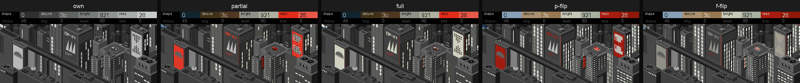
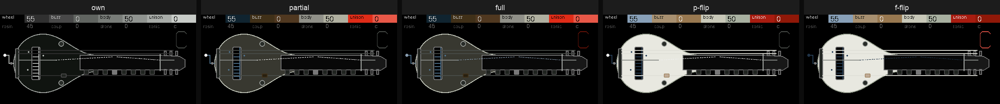
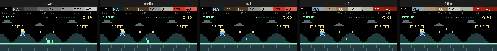

# x2f

Turns an **Open-XY machine** (a synth written for the OP-XY) into an **open-field pack** for the
OP-1 Field: a `.pack` file you copy onto the Field beside `base.pack`. The synth shows up in the engine list
(shift + T1), with the machine's own screen when one exists.

**v1** covers synths. open-field has no drum-engine slot, so Open-XY drum kits land under synths too. Effects and
sampling are not in this release. Heavy ports (rings and similar) can slow the Field UI while audio still runs —
expected for v1, not a broken pack. Pull requests welcome.

Unofficial; not affiliated with Teenage Engineering. See [NOTICE](NOTICE).

## Quick start

Use `python` below; on some systems it is `python3` (Linux, macOS) or `py` (Windows).

```bash
python x2f.py setup                       # point x2f at what it needs; it can git clone what you don't have
python x2f.py check                       # karplus (synth): render, look, listen, build
python x2f.py build PATH/TO/MACHINE       # your machine -> out/<name>/<name>.pack
```

Then copy `out/<name>/<name>.pack` into the Field's `packs` folder (disk mode), beside `base.pack`, and restart.

## What you need

x2f is one Python script (`x2f.py`, with `face.py` and the `runtime/` folder). It uses the Python standard
library only: no `pip`, `uv`, or virtual environment. Clone or copy the folder anywhere.

| Need | Why | x2f can get it? |
| --- | --- | --- |
| **Python 3.8+** | runs x2f and open-field's own pack builder | no: python.org, or your package manager |
| **open-field** checkout | its pack builder (`tools/pack_build.py`), headers, linker and profile for OS 1.7.3 | yes (`clone`) |
| **open-xy** checkout, with its **Blackfin toolchain** | the OP-XY SDK headers the machines use, and the compiler for the Field's processor | yes (`clone`, then `python sdk.py toolchain fetch`, which picks your OS) |
| **A C++17 compiler for your computer** | measures which knob owns which part of the screen, and renders the check | no. macOS: `xcode-select --install`. Debian/Ubuntu: `sudo apt install g++`. Fedora: `sudo dnf install gcc-c++`. Windows: LLVM (`clang++`) or MSYS2's mingw-w64 `g++`, on PATH. MSVC's `cl` is not supported |
| **Open-XY machines** (only for `check`) | something to translate; `check` uses `karplus` | yes (`clone`) |
| **git** (only for `clone`) | x2f's `clone` runs it | no: git-scm.com, or your package manager |

## Pointing x2f at things

x2f has **no default locations**. It remembers what you point it to in `x2f.config.json` beside `x2f.py`
(yours: it is not committed), and checks each one every time it runs.

- **First run.** `python x2f.py setup` asks for each one in turn. Type the folder (or the compiler's name or
  path), or type `clone` to git clone it: it asks which repository (Enter takes the one shown) and which
  folder to clone into, clones it and, for open-xy, fetches the toolchain. Each answer is checked before it is kept (an open-field checkout has `tools/pack_build.py`; an
  open-xy checkout has the SDK headers and the toolchain; a compiler must compile C++17), and a wrong one is
  refused with the reason. Running `build` or `check` with nothing set asks the same questions.
- **Without questions** (scripts, CI): give everything as flags:
  `python x2f.py setup --open-field PATH --open-xy PATH --machines PATH --host-cxx clang++`.
  A flag on any command (`build --open-xy PATH ...`) also replaces the remembered place, and is remembered.
- **When something moves.** If a remembered folder is gone or no longer holds what it should, x2f says so,
  names what it remembered, and asks for the new place (or, without a terminal, prints the `setup` command that
  fixes it). Nothing runs on a stale location.
- **See and change what is remembered.**

```bash
python x2f.py where                       # what is remembered, and whether each still holds
python x2f.py setup                       # go through them again (keep each with Enter)
python x2f.py setup --open-xy NEW_PATH    # change just one
python x2f.py reset open_xy               # forget one (open_field, open_xy, machines, host_cxx)
python x2f.py reset                       # forget everything
python x2f.py clone open_xy --into FOLDER [--from URL]   # git clone one now (open_field, open_xy, machines)
```

**Which repository.** Projects change hands, so nothing is fixed. `clone` offers, in order: the repository you
last cloned that thing from (remembered, shown by `where`), else where each project lives as of this writing:

| | Repository offered first time |
| --- | --- |
| `open_field` | https://github.com/LaP0573/open-field.git |
| `open_xy` | https://github.com/etcetc000/open-xy.git |
| `machines` | https://github.com/etcetc000/open-xy-core-machines.git |

Type another at the prompt, or give `--from` (any URL or path git accepts: a fork, a mirror, an SSH address,
a local folder). A checkout you made yourself, from anywhere, works the same: just point `setup` at its folder.
`reset` forgets the repository with the folder.

Relative paths you type are taken from the x2f folder and kept as full paths. Paths with spaces and Windows
backslashes are fine.

## What you get

`python x2f.py build <machine>` writes `out/<name>/`:

| File | What |
| --- | --- |
| `<name>.pack` | the pack, for the Field's `packs` folder |
| `x2f_<name>.cpp` | the generated wrapper that runs the machine on open-field |
| `x2f_<name>_face.cpp` | the generated screen, for a synth with a screen |
| `recipe.json`, `*_card.s`, `*.s`, `build/` | what open-field's pack builder read and made |

`python x2f.py check` also writes a `.wav` to listen to (a 220 Hz karplus note at 88.2 kHz) and
`x2f_karplus_screen.png`: the translated screen after two notes. Letters in the picture are placeholder blocks
(the Field draws its own font). It prints PASS when the note comes out at the right pitch and level and the pack
builds. That is the only check x2f has.

Options for `build` (and `translate`, which writes the wrapper without building):

| Option | |
| --- | --- |
| `--name NAME` | the name in the Field's lists (default: the machine's id). 1-15 of a-z 0-9 space - _ |
| `--cycles N` | the cost one call declares (synth: per voice, at most 40,000; default the most). The Field switches an engine off when a call takes longer than it declared |
| `--rides EFFECT` | reserved for effects (not in v1) |

x2f never writes into the open-field or open-xy folders: it runs open-field's pack builder in its own process
with the toolchain pointed at open-xy's, and everything it makes goes to `out/`.

## How a machine is mapped

| Open-XY | open-field | How |
| --- | --- | --- |
| synth: 64 frames at 44.1 kHz, Q31 | engine: 128 frames at 88.2 kHz, Q31 | one machine block per engine block, 2x upsampled by the Kaiser halfband-127 from Tekkon-1's open_xy backend (`runtime/x2f_rt.h`); 1.4 ms latency |
| pitch increment `2^32 f / 44100` | `step` = `2^32 f / 88200` | the machine gets `2 * step` |
| parameter (linear, exponential, power, anchors) | value 0..32767 | `v * 65538`, 32767 -> 2^31-1 (Tekkon-1's conversion) |
| parameter `enum` of n labels | value 0..n-1 | the k-th knob detent, `floor((k(2^31-1) + (n-1)/2)/(n-1))` |
| more than 8 parameters | | the rest stay at their defaults |
| new note on a fresh voice / on a sounding voice | `OP1F_VOICE_BEGINS` | zero + `initialize` + `start` / `start` only (its retrigger). Note-off changes nothing in the machine: the Field's envelope owns the release |
| `Shared` | one per pack | |
| `native/*.s` hand-written routines | extra pack sources | the build stops if anything the pack calls is undefined (open-field's linker would otherwise ignore it, and the Field would jump into nothing) |
| division, 64-bit multiply/divide, memset, memcpy (libgcc on the OP-XY) | private copies inside the pack (`runtime/x2f_rt.h`) | shift-subtract divides: slow where a machine divides, or uses 64-bit numbers, every sample |
| machine.json `sources` and `includes` (or other `.cpp` beside the entry point) | more units in the pack | compiled as the SDK builds them; `<algorithm>`, `<cstdio>` and the like come from open-xy's own `sdk/platform/blackfin/freestanding` |
| `display.cpp` + `panel.svg.fragment` (the OP-XY screen) | the pack's page (`face.py`) | the machine's own `display()` runs every frame; its shapes, moving paths, palette and texts are drawn with open-field's line, box and text painters |
| screen colours | the Field's encoder colours | OP-XY panels are grey. A part that exactly one knob moves or reshapes (measured on your computer by turning each knob) takes that knob's colour: blue `#3C6087`, tan `#8A653C`, gray `#CDD0C2`, orange `#E52817`. White stays white (playback); other parts keep their grey. A band at the bottom names each knob's value, with the machine's own value text in the knob's colour; shift shows values 5-8 |
| a `display.cpp` that does not build against your open-xy (written for a newer or older SDK, or calling OP-XY host services the Field has no counterpart for) | | the pack still builds, with the values page; x2f prints `SCREEN NOT TRANSLATED` and the compiler's reason |
| no `display.cpp` | | a page of the values (percent, or the choice's label) in the knob colours |

## Pitch: noticed, explained, your call

Every synth build plays A3 (220 Hz) twice on your computer, the original the way the OP-XY SDK plays it and the
translation the way open-field plays it, measures both, and leaves both beside the pack to listen to:
`original-A3.wav` and `translated-A3.wav`. Then:

- **They differ** (more than 15 cents): `TRANSLATION CHANGES PITCH`. x2f offers `[m]atch the original`.
- **They agree but A3 is not 220 Hz**: the machine's own tuning.
- Either way x2f asks: `[m]atch the original`, `[k]eep as it is`, `[f]ix so A3 = 220 Hz`, or what A3 should
  sound as, a note (`C4`, `Bb2`) or Hz (`261.63`), with A2 = 110, A3 = 220, middle C = 261.63, A4 = 440 shown.
  The answer is remembered for that machine; `--tune keep|match|fix|C4|261.63` says it without asking. Without
  a terminal it keeps the sound as it is and says how to change it.
- No single pitch (bells, noise, drums): nothing to flag.

**Straight port and fixed side by side.** `library` builds, for every synth flagged above, a second pack named
`<name>-fix` (`<first 13 letters>-f` when the name is long): the translation matched to the original, or a machine
tuned off A3 set to 220 Hz. A different name, so both can sit on the Field together. `--name` renames any build.

## Controls that do not fit on the knobs

The Field gives an engine 8 values (4 knobs, and 4 with shift). When a machine has more,
x2f prints which are on the knobs and which are fixed, and you choose:

```bash
python x2f.py build hkinaroom --knobs size,erosion,fade,capture --set capture=on --set fade=50%
```

`--set` takes 0..1, a percent, or a choice's label. Both are remembered for that machine. The default when you
choose nothing follows the SDK: a machine's first four controls own the four knobs. A synth's later controls
are alternates the OP-XY reaches by pressing an encoder (`"control": k` names which); on the Field they are the
same knob with Shift.

## Screen colours: five looks in every pack

Every translated screen carries five looks, chosen on the Field, kept across restarts:

| Look | What takes a knob's colour |
| --- | --- |
| `own` | nothing: the machine's colours as it drew them |
| `partial` (the default) | a part exactly one knob moves; white stays white (playback) |
| `full` | every part a knob moves, white parts too; one colour an object (the knob moving most of it) |
| `p-flip`, `f-flip` | partial and full with the shades reversed: dark greys take the light shades, light greys the dark |

Choose it in the Field's settings (shift + COM, T1, PACKS, the pack's name, `colours`), or on the machine's page:
**hold all four knobs down and tap shift**; the page says which look is on. Only grey parts are ever recoloured,
so a machine that chose its own colours (bitflip) keeps them under `own`. Which knob moves what is measured on your
computer by turning each of the eight values in the machine's own screen code with a note playing.
`--colours MODE` on a build (or `setup --colours MODE`) sets the look a pack starts with.

Host renders of the five looks (same path the pack uses on the Field), left to right:

**nexus**



**hurdygurdy**



**bitflip**



## Text

Every text a translated page draws (the header, a machine's text slots, a panel's fixed text, the values page) is
set in **Perun Light** (SIL Open Font License 1.1: `runtime/font/OFL.txt`), rendered by `tools/make_font.py` into
4-bit glyphs at 11, 14 and 18 pixels (`runtime/x2f_font.h`, about 14 KB a pack) and painted with open-field's
coverage masks, so letters have soft edges in any colour. Placed by baseline, as an SVG text is.

## Drum kits (under synths)

An OP-XY drum kit (`"kind": "drum"`) becomes a **synth engine** that plays the kit across the keyboard, as the
OP-XY's drum track does: the Field's 24 keys from F (the lowest key at the middle octave) are the kit's 24 keys,
each playing its own model and controls (`drum_defaults`), and the engine's eight values are the track's eight
parameters, offsetting every key's controls (`(word >> 24) - 64`, as the SDK does). Look for them with the other
synths. Not yet: editing one key's own model and controls on the Field.

## What open-field cannot run

- **MORPH's capture machine**: it needs headers from an OP-XY SDK that changes the OP-XY's own firmware (its
  repository ships those firmware patches). x2f translates machines, not OP-XY firmware, so it says
  `not supported on open-field`.
- **Players** (note generators: chords, splitter, meikyu) are not translated yet; open-field's sequencer ask is
  where they would go.
- **Machines that need private tables you do not have.** Point `--include DIR` at headers you are allowed to use;
  x2f does not ship or fetch private content.

## A library of everything, to choose from

```bash
python x2f.py library FOLDER... [--skip NAME]   # e.g. python x2f.py library ~/machines --skip dupe
```

Builds every **synth** (and drum kit, as a synth) under the folders into `out/library/packs/x2f-<name>.pack` and
writes `out/library/library.json`. Effects and samplers are skipped in v1 (`X2F_EFFECTS=1` / `X2F_SAMPLERS=1`
build them for development). Packs that share a name get `-2`, `-3`... and a note: the Field registers only the
first of a name.

## Will these packs run together?

```bash
python x2f.py fit PACKS_FOLDER [more.pack ...]
```

Reads any open-field pack (not only x2f's): what each adds (synth engine, effect, sequencer...), the room it
takes, and the loader's limits: 32 packs, 8 synth engines, 16 effects, a room of 2,031,616 bytes filled in the
order of the files' names (a pack past the end is left out). It says `fits` or what does not. Name x2f's packs
so they sort after `base.pack` (the set below uses `x2f-<name>.pack`).

## When a machine was written for another SDK

- A screen that reads `Input.held_pitches` (the mda ports; that field was never in a published open-xy):
  x2f adds it to a private copy of the SDK headers and fills it from the notes held, as it fills `held_notes`.
- An SDK 1.0 screen (`Frame<paths, points, nodes, palette>`): the copy's `Frame` takes four sizes as well as five.
- A screen that calls OP-XY host services: `opxy_synth_shift` (the Shift row: the Field's shift layer, values
  5-8) and `sdk_control_display` (a control's value) are answered from the Field's values.
- A header the machine needs but does not ship (a private table): x2f names it; `--include DIR` points to it.

## What is not done yet

- Effects, sampling, and players (note generators): not in v1.
- Declared cycles are the most allowed, not measured: pass `--cycles` once you know.
- Velocity, tempo (the machine sees no tempo and uses its own fallback), and a synth's presets (as Field sounds)
  are not translated. Stereo synths are untested.
- Screen: drawn 1:1 (both screens are 480 wide) with no re-layout; the bottom band can overlap art drawn low on
  a panel.
- The machine is compiled with `-fno-schedule-insns2` (assembler anomaly 05000074), so it runs a little slower.
- Windows and Linux paths are written for but less exercised than macOS.

## Contributing

PRs welcome. Keep private machine tables, firmware, and local config out of the tree (`x2f.config.json` and
`out/` are gitignored on purpose).
